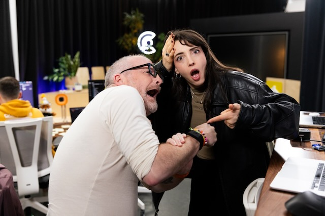
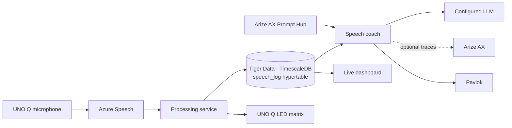

# Well Actually

Well Actually is an experimental live-speech demo built for CodeTV. With
**Tiger Data as the event sponsor, TimescaleDB is at the center** of the
experience; **Arize AX** provides managed prompts and LLM observability.

Audio captured on an Arduino UNO Q is transcribed and diarized by Azure Speech.
Final transcript segments are written to a TimescaleDB hypertable. A speech
coach reads recent speaker transitions from that same data, evaluates them with
a configured OpenAI-compatible LLM, and can signal an opted-in Pavlok device.
A live dashboard makes the stored speech and device activations visible.

## Why TimescaleDB

TimescaleDB is the shared store for the demo's timestamped, speaker-labeled
speech segments. The processing service writes finalized Azure Speech results
to `public.speech_log`; the speech coach queries rolling time windows and
speaker transitions; and the dashboard streams the same records to the browser.
This keeps capture, analysis, and visualization centered on one time-series
dataset.

## Why Arize AX

The speech coach loads its versioned classifier prompt from Arize AX Prompt Hub,
including separate prompt modes for staging and production. OpenAI SDK trace
export to Arize AX is optional and can include conversation text, model output,
and call metadata for inspection. Prompt Hub access is required by the worker,
even when trace export is disabled.

## Components

- [Processing service](processing-service/README.md) — streams audio to Azure
  Speech, stores finalized transcripts in TimescaleDB, and signals the UNO Q
  LED matrix when it recognizes “Well actually”.
- [Speech coach](comp-service/README.md) — evaluates speaker transitions and
  can activate an opted-in Pavlok device.
- [Live speech dashboard](web-app/README.md) — displays speech-log rows from
  TimescaleDB.

## Privacy and demo scope

Use only with participants who have consented to capture and transcription.
Selected dialogue is sent to the configured LLM provider; if Arize trace export
is enabled, conversation text and model responses are also sent to Arize AX.
This is a fallible demo signal, not a reliable judgment of intent or a basis
for evaluating people.
