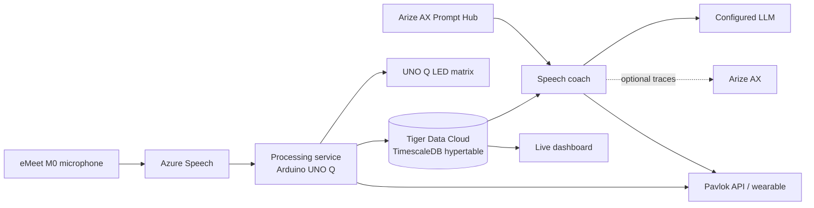

# Well Actually

Well Actually is a mansplaining trainer! Using the power of AI, if you are
detected mansplaining, being condescending, or using the phrase “well actually”
you are in for a shock... literally!

Built for CodeTV, with **Tiger Data as the event sponsor**, the demo puts
**TimescaleDB** at the center of the experience and uses **Arize AX** for
managed prompts and LLM observability.


## How it works

The Arduino UNO Q captures conversation audio and sends it to Azure Speech for
transcription and speaker diarization. The system detects the phrase “well
actually” in finalized transcripts, and a speech coach uses an LLM to assess
recent speaker transitions for condescending or repetitive explanations. When
a configured trigger fires, the system can send a stimulus to an opted-in
Pavlok wearable. This is a fallible comedy demo, not a reliable judgment of
intent or a basis for evaluating people.

## Architecture

The microphone audio is transcribed and diarized by Azure Speech. The processing
service writes finalized speech segments to Tiger Data's TimescaleDB hypertable.
The speech coach queries recent speaker transitions from that same data and
uses an LLM to decide whether to activate an opted-in Pavlok device. The live
dashboard streams the stored speech and activation state to a browser.



## Provisioning and running

Clone the repository once, then run each component in its own terminal from the
repository root:

```sh
git clone https://github.com/jimbobbennett/well-actually.git
cd well-actually
```

### Services and accounts

Provision or configure these before running the complete demo:

1. **Tiger Data Cloud / TimescaleDB:** create a PostgreSQL service and database.
   The application expects a TLS connection URI and a `public.speech_log`
   hypertable with `time`, `sid`, `content`, `ms_score`, and `zap_sent` columns.
   The processing service writes finalized speech, the coach reads it and
   updates activation status, and the dashboard reads the same table.
2. **Azure AI Speech:** create a Speech resource and collect its endpoint, key,
   and recognition language.
3. **Arize AX:** create or select a project, API key, and Prompt Hub IDs for the
   original and sensitive classifier prompts. Prompt Hub access is required by
   the speech coach. AX trace export is optional.
4. **OpenAI-compatible LLM provider:** configure a Chat Completions endpoint,
   model name, and API key for the speech coach.
5. **Pavlok:** configure an API authorization value if you want device
   activation. It is optional for the processing service, but required by the
   speech coach, which can activate the real device.

The coach's `TESTING_MODE` is **not** a dry run: it still calls the LLM and can
activate Pavlok. Only run with participant consent and an opted-in wearer.

### Tools and hardware

- Arduino UNO Q with Arduino App Lab, a compatible USB microphone (the eMeet M0
  was tested), and network access.
- Python 3.11 or newer (the processing service and dashboard also support
  Python 3.10).
- On the UNO Q: `python3-venv`, `alsa-utils` (`arecord`), and
  `arduino-app-cli`.
- On the development computer: Git, Python/pip, and SSH/tar for deploying to
  the UNO Q. A browser is needed for the Tiger Data, Azure, Arize, model
  provider, and Pavlok consoles. Docker is optional for the dashboard; no cloud
  infrastructure templates are included.

The Tiger Data database must provide a TLS-enabled PostgreSQL URI and a
`public.speech_log` TimescaleDB hypertable. If you are creating the table from
scratch, the application expects these columns:

```sql
CREATE TABLE public.speech_log (
    time TIMESTAMP PRIMARY KEY,
    sid INTEGER,
    content TEXT,
    ms_score INTEGER,
    zap_sent BOOLEAN
);

SELECT create_hypertable('public.speech_log', 'time');
```

The `time` column stores UTC timestamps as `TIMESTAMP` without a timezone.
Create the schema once in Tiger Cloud before starting the services. Do not put
the database URI or provider keys in source control.

### Run the processing service on the UNO Q

Configure the UNO Q with Azure Speech and Tiger Data credentials. The deploy
script transfers the processing service and installs its systemd user unit; it
does not transfer `.env` or start the service. From the repository root:

```sh
cd processing-service
UNO_HOST=arduino@192.168.1.42 ./deploy/deploy-to-uno.sh
```

Replace the example IP with the UNO Q's reachable hostname or address.
On the UNO Q, create
`~/.config/well-actually-processing/service.env` with `AZURE_SPEECH_ENDPOINT`,
`AZURE_SPEECH_KEY`, `AZURE_SPEECH_LANGUAGE`, and `TIMESCALEDB_URL`. Add
`WAKE_WORD_API_TOKEN` only if enabling Pavlok from this service. Secure the file
with mode `600`, then start the unit:

```sh
ssh arduino@192.168.1.42 'chmod 600 ~/.config/well-actually-processing/service.env && systemctl --user start well-actually-processing.service'
```

See [processing-service setup](processing-service/README.md) for microphone
checks, environment options, and service logs.

### Run the speech coach

The speech coach requires a valid Pavlok authorization and
`WEARER_OPTED_IN=true` to start. It has no dry-run mode and can trigger the real
device. Do not run it without an opted-in wearer and an understanding of the
configured stimulus. In a separate terminal at the repository root, install
its dependencies and configure its `.env` with
`DATABASE_URL`, `OPENAI_BASE_URL`, `OPENAI_MODEL`, `OPENAI_API_KEY`,
`ARIZE_API_KEY`, both prompt IDs, and `PAVLOK_AUTHORIZATION`:

```sh
cd comp-service
python3 -m venv .venv
.venv/bin/python -m pip install -e .
cp -n .env.example .env
# Edit .env with your service credentials and prompt IDs.
.venv/bin/speech-coach
```

The coach can run continuously or with `--once`; either mode may trigger a
real Pavlok activation. See [speech coach documentation](comp-service/README.md)
for prompt selection, test-table mode, and tracing.

### Run the live dashboard

In another terminal, configure `web-app/.env` with the Tiger Data
`TIMESCALEDB_URL`, then run:

```sh
cd web-app
python3 -m venv .venv
.venv/bin/python -m pip install -r requirements.txt
cp -n .env.example .env
# Edit .env with the database URI.
.venv/bin/uvicorn app:app --reload --host 127.0.0.1 --port 8000
```

Open `http://127.0.0.1:8000`. Keep the dashboard bound to localhost unless you
add authentication and transport security. A Dockerfile is also provided in
`web-app/` for container builds. From `web-app/`, run:

```sh
docker build -t well-actually-dashboard .
docker run --rm -p 8000:8000 --env-file .env well-actually-dashboard
```

Each component has independent tests; run them from its directory with
`python -m unittest discover -s tests`.

## Service roles

| Role | Hardware or service | How it is used |
|---|---|---|
| Audio capture | Arduino UNO Q and eMeet M0 USB microphone | Captures meeting audio and runs the always-on processing service. |
| Transcription | Azure AI Speech | Streams transcription and speaker diarization to the processing service. |
| Time-series data | Tiger Data Cloud / TimescaleDB | Stores finalized segments in `public.speech_log`; the coach and dashboard query the same hypertable. |
| Prompt management | Arize AX Prompt Hub | Supplies the versioned classifier prompt used by the speech coach. |
| LLM evaluation | Configured OpenAI-compatible model | Assesses recent speaker transitions using transcript text. |
| Observability | Arize AX | Optionally receives LLM traces, including conversation text, model output, and call metadata. |
| Feedback | UNO Q LED matrix and Pavlok wearable | Shows a lightning bolt for the recognized phrase; the Pavlok stimulus is configurable. |
| Dashboard | Local Python app or optional Docker container | Serves the live view and connects to Tiger Data using a server-side URI. |

### TimescaleDB is the shared record

The processing service writes finalized transcript segments to
`public.speech_log`, including their timestamps, speaker IDs, text, and
activation status. The speech coach queries rolling time windows and speaker
transitions; the dashboard reads the same hypertable. TimescaleDB therefore
connects live capture to analysis and visualization without copying the
transcript into a separate application database.

The Pavlok stimulus can be configured as a zap, beep, or vibration; a literal
zap depends on the device and stimulus configuration. The speech coach requires
Arize Prompt Hub access at startup, while trace export is optional.

## Components

- [Processing service](processing-service/README.md) — audio capture, Azure
  Speech streaming, TimescaleDB writes, and UNO Q LED signaling.
- [Speech coach](comp-service/README.md) — time-window queries, prompt-managed
  LLM evaluation, optional Arize tracing, and Pavlok activation.
- [Live speech dashboard](web-app/README.md) — a FastAPI and Server-Sent Events
  view over the speech log.

## Privacy and safety

Use only with participants who have consented to capture and transcription.
Selected dialogue is sent to the configured LLM provider; if Arize trace export
is enabled, conversation text and model responses are also sent to Arize AX.
The dashboard has no application login. It listens on localhost by default; do
not expose it to a network or use it for real or sensitive transcripts without
adding authentication and reviewing access controls.

See each component README for local setup, required credentials, and deployment
details. The processing service does not retain raw audio.
