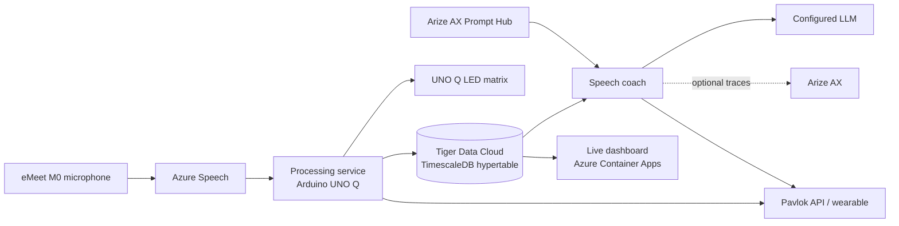

# Well Actually

Well Actually is a mansplaining trainer! Using the power of AI, if you are
detected mansplaining, being condescending, or using the phrase “well actually”
you are in for a shock... literally!

## How it works

This setup is designed to capture mansplaining including saying "well actually", and condescending commentary.

It uses a hardware device to capture audio in a conversation, then AI to identify if a speaker says "well actually". It also uses speaker recognition to detct a conversation, and flag if one speaker is being condescending to the other.

If it spots any of these, it sends a signal to a pavlock bracelet to encurage them not to do it again...

## Architecture

The microphone audio is transcribed and diarized by Azure Speech. The processing
service writes finalized speech segments to Tiger Data's TimescaleDB hypertable.
The speech coach queries recent speaker transitions from that same data and
uses an LLM to decide whether to activate an opted-in Pavlok device. The live
dashboard streams the stored speech and activation state to a browser.

## Hardware and services

| Role | Hardware or service | How it is used |
|---|---|---|
| Audio capture | Arduino UNO Q and eMeet M0 USB microphone | Captures meeting audio and runs the always-on processing service. |
| Transcription | Azure AI Speech | Streams transcription and speaker diarization to the processing service. |
| Time-series data | Tiger Data Cloud / TimescaleDB | Stores finalized segments in `public.speech_log`; the coach and dashboard query the same hypertable. |
| Prompt management | Arize AX Prompt Hub | Supplies the versioned classifier prompt used by the speech coach. |
| LLM evaluation | Configured OpenAI-compatible model | Assesses recent speaker transitions using transcript text. |
| Observability | Arize AX | Optionally receives LLM traces, including conversation text, model output, and call metadata. |
| Feedback | UNO Q LED matrix and Pavlok wearable | Shows a lightning bolt for the recognized phrase; the Pavlok stimulus is configurable. |
| Dashboard hosting | Azure Container Apps | Hosts the live dashboard, which connects to Tiger Data using a secret. |

### TimescaleDB is the shared record

The processing service writes finalized transcript segments to
`public.speech_log`, including their timestamps, speaker IDs, text, and
activation status. The speech coach queries rolling time windows and speaker
transitions; the dashboard reads the same hypertable. TimescaleDB therefore
connects live capture to analysis and visualization without copying the
transcript into a separate application database.

The Pavlok stimulus can be configured as a zap, beep, or vibration; a literal
zap depends on the device and stimulus configuration. The speech coach requires
Arize Prompt Hub access at startup, while trace export is optional.

## Components

- [Processing service](processing-service/README.md) — audio capture, Azure
  Speech streaming, TimescaleDB writes, and UNO Q LED signaling.
- [Speech coach](comp-service/README.md) — time-window queries, prompt-managed
  LLM evaluation, optional Arize tracing, and Pavlok activation.
- [Live speech dashboard](web-app/README.md) — a FastAPI and Server-Sent Events
  view over the speech log.

## Privacy and setup

Use only with participants who have consented to capture and transcription.
Selected dialogue is sent to the configured LLM provider; if Arize trace export
is enabled, conversation text and model responses are also sent to Arize AX.
The Azure demo dashboard is public and has no application login, so do not use
it for real or sensitive transcripts without adding authentication and
reviewing access controls.

See each component README for local setup, required credentials, and deployment
details. The processing service does not retain raw audio.
