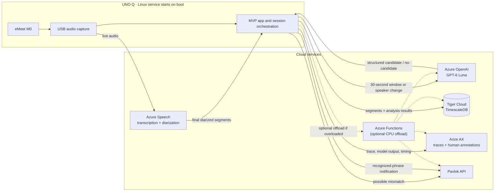

# Well Actually: MVP architecture

**Status:** MVP plan for a four-hour CodeTV demo
**Last reviewed:** 2026-10-21

## Goal

Build a meeting-sidekick prototype that listens to a shared microphone, transcribes speech with speaker labels, and looks for a specific idea-credit pattern: one person proposes an idea, it is not taken up, and another person later restates it as their own. When the pattern is plausible, the system sends a vibration to a Pavlok device. A fast-follow feature matches “well actually” in finalized Azure Speech text and triggers immediately.

This is a signal for a comedy/demo experience, not a reliable judgment of intent or a tool for evaluating people. The audio and transcript alone cannot establish gender, intent, who originated an idea, or all the context of a conversation. The system should report a **possible idea-credit mismatch**, with evidence and uncertainty, rather than claim that a person is definitively mansplaining.

## MVP architecture



For the four-hour MVP, the UNO Q's Linux application owns audio capture, transcript handling, recognized-phrase matching, analysis orchestration, TimescaleDB writes, and Pavlok API calls. Configure it to start automatically at boot and run continuously, creating a session for each boot. Audio transcription/diarization and idea analysis use cloud APIs: Azure Speech and Azure OpenAI with GPT-6 Luna, respectively. Match “well actually” in finalized Azure Speech text, ignoring punctuation and case. Connect directly from the UNO Q to TimescaleDB and Pavlok; do not add an ingestion service, queue, or worker. If the UNO Q cannot sustain the workload, move the app-side analysis and integrations to an Azure service such as Azure Functions.

Treat this as a live demo with a working network and providers. Phrase matching depends on Azure's finalized transcription, but remains independent of idea analysis. Save finalized segments, analysis outcomes, and timestamps to TimescaleDB as the app receives them; losing data during a crash is acceptable for this MVP.

## Component research and decisions

### Audio capture and edge device

Arduino describes UNO Q as combining a Qualcomm QRB2210 MPU running Debian Linux with an STM32U585 MCU. It supports Python applications and AI-at-the-edge workflows. That makes it a plausible place for USB audio capture, a local keyword-spotting process, and device orchestration; actual eMeet M0 compatibility, audio format support, CPU/RAM headroom, and always-on thermal/power behavior still need a hands-on test.

**MVP decision:** connect the eMeet M0 to the UNO Q over USB and capture audio on Linux. Verify device enumeration and sample format/rate as part of bringing up the demo. Run the application as a Linux service so it starts at boot. Do not assume the MCU is the right place for the speech model.

### Transcription and speaker labels

Azure Speech documents real-time speech-to-text and conversation transcription with diarization. Its speaker ID identifies a speaker within the recognized conversation; treat it as a temporary session label, not a real-world identity. Diarization can be uncertain, especially with interruptions, overlap, similar voices, distant participants, or poor microphone placement. Keep the service speaker ID and its confidence/availability with each segment; do not silently assign uncertain speech to a person.

**MVP decision:** use Azure Speech for streaming transcription and diarization. Process finalized segments only; persist each segment directly from the UNO Q. Ignore interim revisions, reconnect recovery, and out-of-order correction handling for this demo.

### TimescaleDB / Tiger Data

Transcript segments are append-heavy, time-ordered data and are a good fit for a Timescale hypertable. A hypertable is a PostgreSQL table partitioned into time chunks while retaining normal PostgreSQL query behavior. Use a `timestamptz` event time as the partition column and include session/speaker indexes for retrieving a conversation window. Keep low-volume relational data—sessions, speaker aliases, configuration, and detection records—in ordinary PostgreSQL tables unless measurements show a time-series table is useful.

Write directly from the UNO Q using a PostgreSQL client and a connection string supplied outside source control. No separate ingestion API or analysis-job table is needed for the MVP. Continuous aggregates, retries, and exactly-once processing are out of scope.

**MVP data model:**

| Entity | Storage | Initial fields |
| --- | --- | --- |
| `sessions` | PostgreSQL table | ID, start/end time |
| `transcript_segments` | Hypertable | Event time, session ID, segment ID, speaker label, text, recognition metadata |
| `analysis_results` | PostgreSQL table | Session ID, window start/end, outcome, confidence, cited segment IDs, explanation, created time |
| `notifications` | PostgreSQL table | Session ID, event type, analysis-result ID or recognized-phrase time, request/result status, created time |

Do not build raw-audio storage for the demo. Keep the hypertable's unique indexes compatible with the time partition column.

### Idea-credit analysis

The core task is not simple keyword detection or semantic similarity. It needs sequence and context:

1. Find an earlier, reasonably specific proposed idea from one speaker.
2. Find a later, semantically similar proposal or explanation from a different speaker within a configurable meeting window.
3. Check whether the later speaker presents it as their contribution and whether they acknowledge the earlier speaker.
4. Return the relevant transcript spans, a short rationale, uncertainty, and a “no candidate” outcome when evidence is weak.

Use Azure OpenAI with GPT-6 Luna on finalized transcript. Configure the Azure deployment name separately from the model name, and verify that GPT-6 Luna is available in the Azure OpenAI resource and supports the required structured response format. Trigger analysis on every finalized speaker change, using the most recent 30 seconds of audio as context. If the same speaker continues, analyze each consecutive 30-second audio window. Require a structured response and validate that cited segment IDs came from the input window.

**MVP qualification rule:** return `possible_mismatch` only when the model identifies (a) a concrete earlier idea, (b) a later semantically similar idea from a different diarized speaker, and (c) no explicit acknowledgment of the earlier speaker in the available window. Require model-reported confidence of at least `0.8` as an initial, uncalibrated threshold. Otherwise return `no_candidate`. This is a demo gate, not a statistically meaningful probability; record the rule and confidence with each result and use Arize AX evaluations to review and tune it against consented examples.

Send the structured input, model/version, output, cited segment IDs, threshold decision, and timing to Arize AX for tracing and evaluation. Keep evidence in the database/trace for evaluation, but the demo notification itself is vibration-only and does not show transcript excerpts or name a participant.

**Important limitation:** text and voice diarization cannot reliably infer gender or intent. Do not infer gender from names or voices. The prototype detects only the observable conversational pattern and describes it as a possible credit mismatch. No cooldown or user-control UI is planned for the MVP.

### Pavlok notification

Pavlok’s published API v5 exposes `POST https://api.pavlok.com/api/v5/stimulus/send`. Its documented stimulus types are `zap`, `beep`, and `vibe`, with values from 1 through 100; the API uses an `Authorization` header. The published login endpoint returns a user token. This means an initial notification integration can be an HTTPS call from the service or UNO Q rather than reverse-engineering Bluetooth behavior.

**MVP decision:** call the published HTTPS API directly from the UNO Q for recognized-phrase events. Configure the stimulus type (`zap`, `beep`, or `vibe`) and level (`1`–`100`) through the service environment; default to `beep` at value `50`. Keep credentials outside source control. No separate notification service, cooldown, or fallback transport is planned.

Confirm that the specific device/account and API access work before relying on this path for a live show; public docs establish the endpoint shape, not device pairing, delivery latency, or service availability guarantees.

### “Well actually” transcript trigger

**Current implementation:** use Azure Speech's finalized recognized text to match adjacent `well` and `actually` words case-insensitively, with punctuation ignored. A match triggers a five-second lightning bolt on the UNO Q LED matrix. The historical Edge Impulse training work is documented in [wake-word data generation and training](wake-word-training.md), but the running app no longer loads that model.

## Processing and notification flow

1. The UNO Q boots, starts the application service, and creates a session. Participants in the demo have consented to capture and transcription.
2. The UNO Q captures audio and streams it to Azure Speech.
3. The UNO Q receives finalized diarized segments, checks each segment for the recognized phrase, and writes it directly to TimescaleDB.
4. On every finalized speaker change, the app analyzes the latest 30 seconds of finalized segments. If a speaker continues, it analyzes each consecutive 30-second audio window. Each run sends a trace to Arize AX.
5. Store both `possible_mismatch` and `no_candidate` results. For a qualifying mismatch, call Pavlok directly and store the notification result.
6. A “well actually” match in finalized transcript text calls Pavlok independently of the transcript-analysis flow.

Use audio/service timestamps as canonical event times and store analysis/notification times for demo evaluation. Interfaces between components are intentionally small and defined below; there is no broker or durable queue.

### MVP component contracts

**Final transcript segment** (Speech service to UNO Q application, then persisted):

```json
{
  "session_id": "string",
  "segment_id": "string",
  "start_ms": 0,
  "end_ms": 0,
  "speaker_id": "string",
  "text": "string",
  "is_final": true,
  "recognition_confidence": 0.0
}
```

**Analysis input** (UNO Q application to Azure OpenAI): `session_id`, `window_start_ms`, `window_end_ms`, `trigger` (`speaker_change` or `speaker_window_elapsed`), and an ordered array of finalized transcript segments using the fields above.

**Analysis output** (LLM to UNO Q application):

```json
{
  "outcome": "possible_mismatch",
  "confidence": 0.0,
  "earlier_segment_ids": ["string"],
  "later_segment_ids": ["string"],
  "acknowledged": false,
  "rationale": "string"
}
```

Use `no_candidate` when the qualification rule is not satisfied. The app rejects citations to segment IDs not present in the analysis input. The app stores this output and sends the input/output plus Azure OpenAI deployment/model and timing metadata to Arize AX. Configure Arize AX with the API key supplied for the demo; add human annotations to the traces in Arize AX to review detections and tune the provisional threshold.

**Pavlok request:** send a `vibe` stimulus for either a qualifying analysis result or a recognized-phrase event. Store the event type and API response status in `notifications`; transcript text is not included in the notification.

## Privacy, safety, and demo constraints

- All participants in the demo are assumed to have consented to capture and transcription.
- Do not retain raw audio. Send only the rolling transcript window needed for idea analysis; do not include participant names.
- Keep provider credentials outside source control.
- Do not use the output for employment decisions, performance management, or public attribution. Present it as a playful, fallible signal with evidence and uncertainty.
- Use vibration only; do not use aversive stimulus types.
- Run as many consented examples as the demo schedule allows. Add human-reviewed annotations to Arize AX traces so false positives and misses can be inspected.

## Implementation sequence

1. **Hardware and credentials:** verify eMeet USB capture on UNO Q; configure Azure Speech, Azure OpenAI (GPT-6 Luna deployment), TimescaleDB, Arize AX, and Pavlok credentials outside source control.
2. **Persistence and transcription:** create the MVP tables, stream to Azure Speech, and write finalized segments directly to TimescaleDB.
3. **Analysis and evaluation:** implement the every-speaker-change/30-second-window trigger, structured GPT-6 Luna result, initial `0.8` threshold, and Arize AX trace/annotation flow.
4. **Notifications:** verify a Pavlok vibration at value `50` for a qualifying result and a “well actually” transcript match.
5. **Demo run:** test with consenting participants, review detections and misses in Arize AX, and adjust the threshold if time permits.
6. **Boot behavior:** configure and verify automatic service startup when the UNO Q boots.

## Deferred beyond the MVP

- Provider comparison, offline operation, retries, transcript correction/reordering, durable queues, deduplication, and recovery.
- Cooldowns, user controls, alert presentation, and calibrated confidence.
- Production retention/deletion policy and operational monitoring beyond Arize AX demo traces.
- If the UNO Q is overloaded, move the app-side analysis and integrations to Azure Functions; keep microphone capture on-device.

## References

- [Arduino UNO Q hardware overview](https://docs.arduino.cc/hardware/uno-q/) — MPU/MCU architecture and Linux/App Lab overview.
- [Azure Speech real-time diarization quickstart](https://learn.microsoft.com/en-us/azure/ai-services/speech-service/get-started-stt-diarization) — real-time conversation transcription and generic per-conversation speaker IDs.
- [Tiger Data: Understand hypertables](https://www.tigerdata.com/docs/learn/hypertables/understand-hypertables) — time-partitioned PostgreSQL tables.
- [Tiger Data: Create and configure a hypertable](https://www.tigerdata.com/docs/learn/hypertables/creating-and-configuring-hypertables) — partition-column and indexing options.
- [Tiger Data: Understand continuous aggregates](https://www.tigerdata.com/docs/learn/continuous-aggregates) — incremental time-series summaries.
- [Pavlok API v5: Create and send a stimulus](https://pavlok.readme.io/reference/stimulus_create_api_v5_stimulus_send_post) — HTTPS endpoint, supported stimulus types, value range, and Authorization header.
- [Pavlok API v5: Login](https://pavlok.readme.io/reference/auth_login_api_v5_users_login_post) — login request and token response.
- [OpenAI: Structured model outputs](https://developers.openai.com/api/docs/guides/structured-outputs) — JSON Schema constrained responses.
