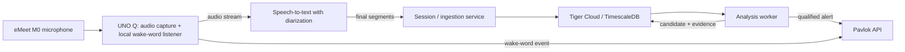

# Well Actually: research and initial architecture

**Status:** Initial research for a CodeTV prototype
**Last reviewed:** 2026-10-21

## Goal

Build a meeting-sidekick prototype that listens to a shared microphone, transcribes speech with speaker labels, and looks for a specific idea-credit pattern: one person proposes an idea, it is not taken up, and another person later restates it as their own. When the pattern is plausible, the system sends a vibration to a Pavlok device. A fast-follow feature locally detects the phrase “well actually” and vibrates immediately.

This is a signal for a comedy/demo experience, not a reliable judgment of intent or a tool for evaluating people. The audio and transcript alone cannot establish gender, intent, who originated an idea, or all the context of a conversation. The system should report a **possible idea-credit mismatch**, with evidence and uncertainty, rather than claim that a person is definitively mansplaining.

## Suggested prototype architecture

Keep the low-latency “well actually” path separate from the slower transcript-analysis path. The wake-word listener should be able to trigger a vibration without waiting for a cloud transcription or LLM call. For the first end-to-end demo, let the UNO Q capture audio and run the wake-word listener locally, while a cloud speech service performs live transcription and diarization. A small service/worker should own database writes, analysis, and the Pavlok API integration. The UNO Q’s Linux environment can run the capture and application code; its MCU is available for deterministic device-side control if needed.

This split gets a complete demo running before attempting on-device speech recognition or an LLM. It also keeps API credentials out of the device firmware and avoids making a small edge board responsible for every stage.

## Component research and decisions

### Audio capture and edge device

Arduino describes UNO Q as combining a Qualcomm QRB2210 MPU running Debian Linux with an STM32U585 MCU. It supports Python applications and AI-at-the-edge workflows. That makes it a plausible place for USB audio capture, a local keyword-spotting process, and device orchestration; actual eMeet M0 compatibility, audio format support, CPU/RAM headroom, and always-on thermal/power behavior still need a hands-on test.

**Initial decision:** connect the eMeet M0 to the UNO Q over USB and prototype capture on Linux first. Verify device enumeration, sample format/rate, and continuous capture under load before choosing the production audio pipeline. Do not assume the MCU is the right place for the speech model.

### Transcription and speaker labels

Azure Speech documents real-time speech-to-text and conversation transcription with diarization. Its speaker ID identifies a speaker within the recognized conversation; treat it as a temporary session label, not a real-world identity. Diarization can be uncertain, especially with interruptions, overlap, similar voices, distant participants, or poor microphone placement. Keep the service speaker ID and its confidence/availability with each segment; do not silently assign uncertain speech to a person.

**Initial decision:** use a cloud diarization service for the first prototype, with Azure Speech as the natural first candidate given the available Azure access. Compare it against one alternate provider on recorded, consented sample conversations before locking it in. Persist finalized transcript segments, timestamps, speaker labels, and available confidence metadata. Treat partial/interim recognition as mutable and avoid running idea analysis against it.

### TimescaleDB / Tiger Data

Transcript segments are append-heavy, time-ordered data and are a good fit for a Timescale hypertable. A hypertable is a PostgreSQL table partitioned into time chunks while retaining normal PostgreSQL query behavior. Use a `timestamptz` event time as the partition column and include session/speaker indexes for retrieving a conversation window. Keep low-volume relational data—sessions, speaker aliases, configuration, and detection records—in ordinary PostgreSQL tables unless measurements show a time-series table is useful.

Timescale continuous aggregates are for incrementally refreshed summaries, such as segment counts or alert counts by time bucket. They are **not** an LLM job runner. Use a small application worker to claim finalized transcript work, analyze it, and persist a result. The worker should be retry-safe and should store which transcript window/version it analyzed so retries do not produce duplicate alerts.

**Draft data model:**

| Entity | Storage | Initial fields |
| --- | --- | --- |
| `sessions` | PostgreSQL table | ID, start/end time, status, consent/configuration metadata |
| `speakers` | PostgreSQL table | Session ID, service speaker label, optional participant-provided alias |
| `transcript_segments` | Hypertable | Start/end timestamps, session ID, segment ID, speaker label, text, final/interim state, recognition metadata |
| `analysis_jobs` | PostgreSQL table | Session/window/version, status, attempts, next retry time |
| `detection_events` | PostgreSQL table | Candidate kind, involved segment references, confidence, explanation/evidence, notification state |

Avoid storing raw audio by default. If audio retention is needed for debugging or evaluation, make it an explicit opt-in with a short retention period and a clear deletion path. Review hypertable unique-index requirements against the selected time partition column when finalizing the schema.

### Idea-credit analysis

The core task is not simple keyword detection or semantic similarity. It needs sequence and context:

1. Find an earlier, reasonably specific proposed idea from one speaker.
2. Find a later, semantically similar proposal or explanation from a different speaker within a configurable meeting window.
3. Check whether the later speaker presents it as their contribution and whether they acknowledge the earlier speaker.
4. Return the relevant transcript spans, a short rationale, uncertainty, and a “no candidate” outcome when evidence is weak.

Use an LLM on a bounded transcript window and require a typed/structured response. OpenAI documents JSON-Schema-constrained structured output; apply equivalent schema validation for whichever model provider is selected. The model should cite segment IDs/timestamps from its input, not invent evidence. An embedding/similarity pass could later reduce LLM calls, but is not required for the first demo and should not independently trigger a vibration.

**Important limitation:** text and voice diarization cannot reliably infer gender or intent. Do not infer gender from names or voices. The prototype should detect the observable conversational pattern and describe it as a possible credit mismatch. It should avoid naming/shaming a participant, and the alert should be rate-limited and easy to disable.

### Pavlok notification

Pavlok’s published API v5 exposes `POST https://api.pavlok.com/api/v5/stimulus/send`. Its documented stimulus types include `vibe`, with values from 1 through 100; the API uses an `Authorization` header. The published login endpoint returns a user token. This means an initial notification integration can be an HTTPS call from the service or UNO Q rather than reverse-engineering Bluetooth behavior.

**Initial decision:** put the Pavlok client behind a small notification adapter. For the transcript-analysis path, call it only after a candidate passes the chosen confidence/rate limit. For wake-word, try the same HTTPS route first and measure end-to-end latency; if that is not sufficiently immediate or the network is unavailable, investigate a supported local transport as a separate spike. Never store account credentials or tokens in source control. Start with a low, user-tested vibration value, not zap/beep, and provide a device-off/disable path.

Confirm that the specific device/account and API access work before relying on this path for a live show; public docs establish the endpoint shape, not device pairing, delivery latency, or service availability guarantees.

### “Well actually” wake word

Keyword spotting is suited to a short phrase that triggers an action, and local detection can keep always-listening audio on-device. Azure’s custom keyword recognition overview says its on-device models can be generated for a short phrase, but also documents that detection expects a short silence before the keyword and does not support detecting it in the middle of an utterance. That may not match casual use of “well actually” inside a sentence.

**Initial decision:** treat this as an on-device keyword-spotting spike, not a guaranteed Azure feature. Test a custom local model against natural pronunciations, background speech, the eMeet’s actual placement, and a “well actually” said mid-sentence. Compare false accepts and missed detections. Keep the detector local if practical, add a short cooldown so repeated detections do not buzz continuously, and send only a wake-word event—not surrounding audio—to the notification path.

## Processing and notification flow

1. An operator starts a session and confirms participants have been informed and the microphone/recording indicator is visible.
2. The UNO Q captures the audio. The local wake-word listener can send a wake-word event independently.
3. The speech service emits interim and finalized diarized segments. The ingestion service persists finalized segments and queues affected analysis windows.
4. A worker claims a window, checks for sufficient finalized context, and asks the selected LLM for a schema-validated candidate with evidence references.
5. The worker stores both positive and negative analysis outcomes, so retries and tuning are auditable. A candidate is not automatically a definitive accusation.
6. If policy, confidence, and cooldown checks pass, the notification adapter requests a Pavlok vibration and records the delivery result.

Keep timestamps from the audio/service as the canonical event time; also record ingestion/analysis/notification times to measure latency and debug delays. Use idempotency keys for wake-word events and analysis-window notifications. Failures should be visible in logs/status and retried with bounds; a model or network failure must not be treated as a positive detection.

## Privacy, safety, and demo constraints

- Make recording/transcription explicit, visible, and opt-in for a demo. Follow the recording-consent requirements where the show is recorded or participants are located.
- Do not retain raw audio unless the team has a specific opt-in evaluation need. Define transcript retention and deletion before testing with real conversations.
- Limit cloud inputs to the necessary transcript window, avoid sending participant names unless required, and keep provider credentials in a secret store or deployment environment.
- Do not use the output for employment decisions, performance management, or public attribution. Present it as a playful, fallible signal with evidence and uncertainty.
- Set conservative vibration limits and a global disable control. Use vibration only; do not use aversive stimulus types.
- Test speech recognition and idea attribution against a small set of consented, labeled examples. Measure false positives as well as misses; a detector that often misattributes an idea is not demo-ready.

## Implementation sequence

1. **Hardware spike:** verify eMeet USB capture on UNO Q and record a short, consented sample for pipeline testing.
2. **Transcription spike:** stream audio to a candidate diarization service; inspect finalized segments, speaker labels, partials, and timestamps under overlap/noise.
3. **Database + ingest:** create sessions/speakers and the transcript hypertable; persist finalized segments and test session-window queries.
4. **Analysis-only mode:** run the bounded-window detector and save candidate/no-candidate outcomes without buzzing. Review examples and tune its output schema and threshold.
5. **Pavlok spike:** verify API authentication, a conservative test vibration, error handling, and measured delivery latency.
6. **End-to-end demo:** enable rate-limited notifications only after analysis-only behavior is acceptable.
7. **Fast follow:** prototype local “well actually” detection on UNO Q, benchmark false accepts/misses and latency, then route the event to the same notification adapter.

## Open decisions / experiments

- Which cloud speech provider gives the best diarization on the actual microphone and demo environment?
- What latency is acceptable for the analysis-triggered vibration, and what cooldown avoids distracting repeated alerts?
- What time window and evidence threshold distinguish a meaningful credit mismatch from ordinary paraphrase, acknowledgment, or collaboration?
- Is the UNO Q able to sustain the preferred local keyword model alongside USB audio and network streaming?
- Does the Pavlok account/device accept API-triggered vibration reliably, and is its latency low enough for the immediate wake-word experience?
- What consent, retention, and deletion controls are needed for the show’s recording context?

## References

- [Arduino UNO Q hardware overview](https://docs.arduino.cc/hardware/uno-q/) — MPU/MCU architecture and Linux/App Lab overview.
- [Azure Speech real-time diarization quickstart](https://learn.microsoft.com/en-us/azure/ai-services/speech-service/get-started-stt-diarization) — real-time conversation transcription and generic per-conversation speaker IDs.
- [Azure Speech keyword recognition overview](https://learn.microsoft.com/en-us/azure/ai-services/speech-service/keyword-recognition-overview) — local custom keyword models and detection constraints.
- [Tiger Data: Understand hypertables](https://www.tigerdata.com/docs/learn/hypertables/understand-hypertables) — time-partitioned PostgreSQL tables.
- [Tiger Data: Create and configure a hypertable](https://www.tigerdata.com/docs/learn/hypertables/creating-and-configuring-hypertables) — partition-column and indexing options.
- [Tiger Data: Understand continuous aggregates](https://www.tigerdata.com/docs/learn/continuous-aggregates) — incremental time-series summaries.
- [Pavlok API v5: Create and send a stimulus](https://pavlok.readme.io/reference/stimulus_create_api_v5_stimulus_send_post) — HTTPS endpoint, supported stimulus types, value range, and Authorization header.
- [Pavlok API v5: Login](https://pavlok.readme.io/reference/auth_login_api_v5_users_login_post) — login request and token response.
- [OpenAI: Structured model outputs](https://developers.openai.com/api/docs/guides/structured-outputs) — JSON Schema constrained responses.
